# EdgeFlow Programming Language & Compiler

**Course:** Compiler Construction (CS / FAST-NUCES)  
**Project:** EdgeFlow — A Vision-Native Programming Language, Interpreter (Phase 1) & LLVM AOT Compiler (Phase 2)

---

## 1. Project Overview

**EdgeFlow** is a domain-specific programming language designed to unify general-purpose algorithmic programming with computer-vision workflows. The project is structured into two self-contained phases:

1. **Phase 1: Pure Interpreter (60% Marks)**
   - Developed using **FLEX and Bison only**.
   - **No intermediate code** and **no LLVM** are involved.
   - The interpreter executes the program directly using C++ semantic actions inside the Bison grammar file (`interpreter/interpreter.y`).
   - Self-contained, lightweight binary: `edgeflow-interp`.

2. **Phase 2: Ahead-Of-Time (AOT) LLVM Compiler (40% Marks)**
   - Full compiler front-end (Flex + Bison) producing a typed Abstract Syntax Tree (AST).
   - AST-level semantic analysis (type checking, scope resolution, diagnostics).
   - AST-level peephole and dead-code optimizations.
   - Lowers directly into **LLVM Intermediate Representation (`.ll`)**.
   - Ahead-Of-Time compiled via Clang and linked against an OpenCV C++ runtime (`libedgeruntime.a`) into standalone native executables: `edgeflow`.

---

## 2. Compiler & Interpreter Architecture

```mermaid
graph TD
    subgraph "Phase 1: Pure Interpreter (Flex + Bison only)"
        P1_SRC[Source Code .edge] --> P1_FLEX[Lexer: lexer_interp.l]
        P1_FLEX --> P1_BISON[Parser: interpreter.y]
        P1_BISON --> P1_EXEC[C++ Grammar Action Execution]
        P1_EXEC --> P1_OUT[Program Output / stdout]
    end

    subgraph "Phase 2: AOT Compiler (LLVM + OpenCV)"
        P2_SRC[Source Code .edge] --> P2_FLEX[Lexer: lexer.l]
        P2_FLEX --> P2_BISON[Parser: parser.y]
        P2_BISON --> P2_AST[Abstract Syntax Tree]
        P2_AST --> P2_SEM[Semantic Analysis]
        P2_SEM --> P2_OPT[AST Optimizations DCE & Redundancy]
        P2_OPT --> P2_LLVM[LLVM IR CodeGen: CodeGen.cpp]
        P2_LLVM --> P2_IR[LLVM IR .ll]
        P2_IR --> P2_CLANG[Clang AOT Linker]
        P2_RT[OpenCV Vision Runtime C++] --> P2_CLANG
        P2_CLANG --> P2_BIN[Native Binary Executable]
    end
```



---

## 3. Directory & File Inventory

```
vision-compiler/
├── CMakeLists.txt              # Unified CMake build configuration (Phase 1 & Phase 2)
├── README.md                   # Complete documentation and usage guide
├── DEVELOPMENT.md              # Milestones and development logs
├── EdgeFlow_Compiler_Project_Proposal.pdf # Course project proposal
│
├── interpreter/                # === Phase 1: Pure Interpreter ===
│   ├── interpreter.y           # Bison grammar with direct C++ execution logic
│   ├── lexer_interp.l          # Dedicated Flex lexer for Phase 1
│   └── main_interp.cpp         # Main entry point calling yyparse()
│
├── lexer/                      # === Phase 2: Compiler Lexer ===
│   └── lexer.l                 # Flex lexical scanner for AOT compiler
│
├── parser/                     # === Phase 2: Compiler Parser ===
│   └── parser.y                # Bison parser creating typed AST nodes
│
├── include/                    # === Phase 2: Header Files ===
│   ├── AST.h                   # Abstract Syntax Tree classes & visitor interfaces
│   ├── CodeGen.h               # LLVM IR code generator declaration
│   └── Semantic.h              # Semantic analyzer and diagnostic rules
│
├── src/                        # === Phase 2: Compiler Implementation ===
│   ├── main.cpp                # Compiler CLI driver (--ast, -o, etc.)
│   ├── AST.cpp                 # AST implementation & optimization passes
│   ├── CodeGen.cpp             # LLVM IR emission using LLVM C++ API
│   └── Semantic.cpp            # Scope checking and semantic diagnostics
│
├── runtime/                    # === Phase 2: Vision Runtime ===
│   └── vision_runtime.cpp      # OpenCV C++ runtime (image ops, camera, YOLO AI)
│
├── examples/                   # === Test & Demonstration Programs ===
│   ├── basic.edge              # Arithmetic, precedence, expressions
│   ├── control_flow.edge       # choose/otherwise, while loop, range loop
│   ├── functions.edge          # Functions, parameter passing, recursion (factorial)
│   ├── arrays.edge             # Array declarations, updates, indexing
│   ├── insertion_sort.edge     # Required sorting algorithm demonstration
│   ├── semantic_test.edge      # Semantic diagnostic test cases
│   ├── optimize.edge           # Dead code and redundant call optimization demo
│   ├── vision.edge             # Computer vision pipeline (load, resize, blur, save)
│   ├── camera.edge             # Real-time camera capture loop
│   └── ai.edge                 # ONNX YOLO deep learning object detection
│
└── tests/
    └── run_phase1_tests.sh     # Automated automated regression test suite for Phase 1
```

---

## 4. Dependencies & Prerequisites

### Linux (Ubuntu 22.04 / 24.04 / Debian)
```bash
# Core prerequisites for Phase 1 (Flex & Bison Interpreter):
sudo apt-get update
sudo apt-get install -y cmake ninja-build flex bison build-essential

# Optional prerequisites for Phase 2 (LLVM AOT Compiler & Vision Runtime):
sudo apt-get install -y llvm-18 clang-18 libopencv-dev
```

### Windows (WSL recommended)
For best results matching the grading environment, build inside WSL (Ubuntu):
```bash
wsl
cd /mnt/d/FAST/7th\ semester/CC/vision-compiler
```

---

## 5. Phase 1: Pure Interpreter (Flex + Bison)

### How It Works
Phase 1 satisfies 60% of the course requirements. The grammar actions directly interpret and execute EdgeFlow statements:
- **Environment Management:** Scalar variables are maintained in `std::map<std::string, long long>`, and arrays are stored in `std::map<std::string, std::vector<long long>>`.
- **Function Dispatch & Recursion:** Functions (`task`) are registered in a function table with their AST bodies and parameter lists. Calling a function creates a fresh local environment, binds arguments, and handles `give` statements via C++ exception signaling (`ReturnSignal`).
- **No LLVM or external libraries:** Zero LLVM or OpenCV dependency is required to build or execute Phase 1.

### Compiling Phase 1
From the project root:
```bash
cmake -S . -B build -G Ninja
cmake --build build --target edgeflow-interp
```

### Running Phase 1 Programs
Execute any `.edge` program directly:
```bash
# Basic arithmetic:
./build/edgeflow-interp examples/basic.edge

# Control flow & loops:
./build/edgeflow-interp examples/control_flow.edge

# Recursive functions:
./build/edgeflow-interp examples/functions.edge

# Array operations:
./build/edgeflow-interp examples/arrays.edge

# Insertion Sort:
./build/edgeflow-interp examples/insertion_sort.edge
```

You can also run EdgeFlow code interactively from standard input:
```bash
./build/edgeflow-interp
make x := 42;
emit x * 2;
# Press Ctrl+D (Linux) or Ctrl+Z (Windows)
```

### Automated Phase 1 Test Suite
Run the automated test runner to verify all Phase 1 test cases:
```bash
bash tests/run_phase1_tests.sh
```
Expected output:
```
[PASS] basic_arithmetic
[PASS] control_flow
[PASS] functions_recursion
[PASS] arrays
[PASS] insertion_sort

=======================================
  5/5 tests passed
=======================================
```

---

## 6. Phase 2: AOT LLVM Compiler & Vision Runtime

### How It Works
Phase 2 translates EdgeFlow into optimized LLVM Intermediate Representation (`.ll`), which is then compiled to native machine code via Clang:
1. `lexer/lexer.l` & `parser/parser.y` produce an Abstract Syntax Tree.
2. `src/Semantic.cpp` performs type checking, scope verification, and error diagnostics.
3. `src/AST.cpp` executes AST-level optimizations:
   - **Dead Code Elimination (DCE):** Eliminates statically dead conditional branches.
   - **Redundant Vision Optimization:** Removes consecutive duplicate resize/grayscale operations.
4. `src/CodeGen.cpp` lowers AST nodes to LLVM IR using the LLVM 18 C++ API.
5. Clang compiles the IR and links it with `runtime/vision_runtime.cpp` (OpenCV).

### Compiling Phase 2
```bash
cmake -S . -B build -G Ninja
cmake --build build
```
This produces the compiler binary: `build/edgeflow` and the runtime library `build/libedgeruntime.a`.

### Running Phase 2 Programs
```bash
# Step 1: Compile .edge to LLVM IR
./build/edgeflow examples/insertion_sort.edge -o sort.ll

# Step 2: Compile LLVM IR to native binary via Clang
clang++ sort.ll -o sort_bin -Lbuild -ledgeruntime $(pkg-config --libs opencv4 2>/dev/null)

# Step 3: Run the native binary
./sort_bin
```

### Compiling & Running Computer Vision Pipelines
```bash
# Vision pipeline example (loading, processing, saving image)
./build/edgeflow examples/vision.edge -o vision.ll
clang++ vision.ll -o vision_bin -Lbuild -ledgeruntime $(pkg-config --libs opencv4)
./vision_bin
```

---

## 7. EdgeFlow Language Reference & Syntax Examples

### Variable Declaration & Assignment
```edge
make a := 10;
make b := 20;
make c := a + b * 2;
emit c;             // Output: 50
```

### Arrays
```edge
make arr[5] := [8, 3, 7, 1, 5];
arr[0] := 10;
emit arr[0];        // Output: 10
```

### Control Flow (If / Else)
```edge
make score := 85;
choose score >= 50 {
    emit 1;         // Pass
} otherwise {
    emit 0;         // Fail
}
```

### Loops
```edge
// While loop:
make count := 5;
repeat while count > 0 {
    emit count;
    count := count - 1;
}

// Range loop:
repeat i from 0 until 5 {
    emit i;         // Prints 0, 1, 2, 3, 4
}
```

### Functions & Recursion
```edge
task add(x, y) {
    give x + y;
}

task factorial(n) {
    choose n <= 1 {
        give 1;
    } otherwise {
        give n * factorial(n - 1);
    }
}

make res := factorial(5);
emit res;           // Output: 120
```

### Algorithm Demonstration: Insertion Sort (`examples/insertion_sort.edge`)
```edge
task is_greater(a, b) {
    choose a > b { give 1; }
    otherwise { give 0; }
}

make arr[5] := [8, 3, 7, 1, 5];

repeat i from 1 until 5 {
    make key := arr[i];
    make j := i - 1;
    
    make cont := 1;
    choose j >= 0 {
        choose is_greater(arr[j], key) == 1 {
            cont := 1;
        } otherwise {
            cont := 0;
        }
    } otherwise {
        cont := 0;
    }
    
    repeat while cont == 1 {
        arr[j + 1] := arr[j];
        j := j - 1;
        choose j >= 0 {
            choose is_greater(arr[j], key) == 1 {
                cont := 1;
            } otherwise {
                cont := 0;
            }
        } otherwise {
            cont := 0;
        }
    }
    arr[j + 1] := key;
}

repeat i from 0 until 5 {
    emit arr[i];    // Prints sorted array: 1, 3, 5, 7, 8
}
```

---

## 8. Summary of Achievements

| Requirement | Phase | Status | Notes |
|---|---|---|---|
| Flex Lexer | Phase 1 & 2 | Completed | Dedicated lexer for Phase 1; tokenizes all language features |
| Bison Grammar | Phase 1 & 2 | Completed | Phase 1 evaluates in C++; Phase 2 builds typed AST |
| Pure Interpreter | Phase 1 | Completed | Zero LLVM/IR dependency; maps, vectors, dynamic execution |
| Arithmetic & Logic | Phase 1 & 2 | Completed | Precedence, comparisons, short-circuit `and`/`or` |
| Control Flow | Phase 1 & 2 | Completed | `choose ... otherwise`, `repeat while`, `repeat i from ... until` |
| Functions & Recursion | Phase 1 & 2 | Completed | Scoped activation frames, recursive factorial demo |
| Arrays & Indexing | Phase 1 & 2 | Completed | Dynamic bounds-checked indexing and updates |
| Algorithm Demo | Phase 1 & 2 | Completed | Insertion sort verified producing `1, 3, 5, 7, 8` |
| Semantic Diagnostics | Phase 2 | Completed | Type checks, duplicate declarations, line-number reports |
| AST Optimizations | Phase 2 | Completed | Dead code pruning and redundant vision operation DCE |
| LLVM IR Code Generation | Phase 2 | Completed | Emits clean, verifiable `.ll` code |
| OpenCV Vision Runtime | Phase 2 | Completed | Real-time image processing, camera capture, ONNX YOLO |
| Documentation & Test Suite | Phase 1 & 2 | Completed | Automated test script (`run_phase1_tests.sh`) & complete README |
