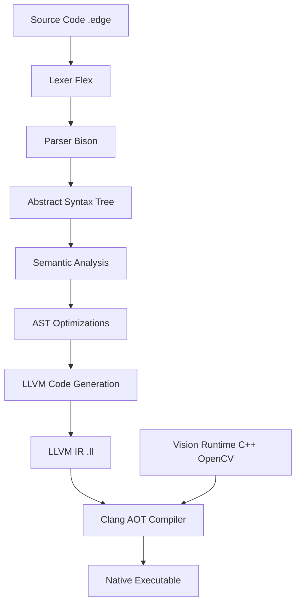

# EdgeFlow Compiler 

EdgeFlow is a small, statically compiled programming language specifically designed for basic algorithmic programming and computer-vision workflows. It uses a modern LLVM-based backend and an OpenCV-powered C++ runtime for computer vision integration.

## Compiler Architecture

EdgeFlow is an Ahead-Of-Time (AOT) compiler. The compilation pipeline is outlined below:



### 1. Lexical Analysis (Flex)
The lexer (`lexer/lexer.l`) tokenizes the source code, supporting standard keywords (`task`, `choose`, `otherwise`, `repeat`, `make`, `give`, `emit`) as well as domain-specific vision aliases (`frame`, `camera`, `model`, `detections`).

### 2. Parsing (Bison)
The parser (`parser/parser.y`) implements the context-free grammar and constructs a fully typed Abstract Syntax Tree (AST). The AST supports variables, control flow, loops, functions, and arrays.

### 3. Semantic Analysis
Before generating code, a recursive semantic pass (`src/Semantic.cpp`) is executed:
- Checks for undefined or duplicate variable definitions.
- Validates arrays are not misused as scalar values (and vice-versa).
- Checks for correct argument counts in function calls.
- Provides informative error messages equipped with exact line numbers.

### 4. AST-Level Optimizations
EdgeFlow integrates two specific AST-level peephole optimization passes:
1. **Dead Code Elimination (DCE):** Analyzes `choose` (if/else) branches and structurally prunes branches with dead conditions (`choose 0`).
2. **Redundant Vision Optimization:** Detects multiple consecutive, identical state mutations like `resize(img, w, h)` on the same variable, removing the unneeded antecedent calls.

### 5. LLVM IR Generation
The optimized AST is lowered directly into LLVM Intermediate Representation (`src/CodeGen.cpp`). EdgeFlow translates its control flows seamlessly using LLVM `BasicBlock` management, utilizing integer extensions (`i64`) dynamically to track pointers safely inside `AllocaInst`.

### 6. Vision Runtime & Linking
A statically linked OpenCV C++ runtime (`runtime/vision_runtime.cpp`) handles complex underlying routines. EdgeFlow links the emitted LLVM IR `vis.ll` alongside the runtime object code `libedgeruntime.a` via Clang, creating natively executable binaries. It seamlessly integrates:
- `load_image()`, `resize()`, `grayscale()`, `blur()`, `save()`, `show()`
- `open_camera()`, `camera_read()`
- `load_model()`, `detect()` (ONNX YOLO)

## Build Instructions
Requirements: `cmake`, `flex`, `bison`, `llvm-18`, `clang`, `opencv4`

```bash
mkdir build && cd build
cmake ..
cmake --build .
```

Compile an EdgeFlow program:
```bash
./build/edgeflow examples/vision.edge -o vis.ll
clang++ vis.ll -o vis -Lbuild -ledgeruntime $(pkg-config --libs opencv4)
./vis
```
