# EdgeFlow Programming Language & Compiler

**Course:** Compiler Construction (CS / FAST-NUCES)  
**Instructor:** Dr. Faisal Aslam  
**Project:** EdgeFlow — Phase 1 (Interpreter) & Phase 2 (AOT Compiler)  
**Target Environment:** Linux (Ubuntu 22.04 / 24.04 LTS, Debian, x86_64)

---

## 1. Executive Summary & Project Requirements Checklist

This repository contains the complete implementation of the **EdgeFlow** compiler construction project, satisfying all requirements for both Phase 1 and Phase 2.

| Phase | Requirement | Weight | Status | Technical Implementation |
|---|---|---|---|---|
| **Phase 1** | **Interpreter Development** | **60%** | **Completed (5/5 Tests Pass)** | Built using **Flex & Bison only**. No intermediate code or LLVM IR is generated. Execution occurs directly inside Bison grammar actions via C++ runtime structures (`std::map`, vectors, exception signals). Binary: `edgeflow-interp`. |
| **Phase 2** | **AOT Compiler Development** | **40%** | **Completed (5/5 Tests Pass)** | Flex lexer + Bison parser emit typed AST, perform semantic analysis and optimizations, then lower to **LLVM Intermediate Representation (`.ll`)** using LLVM 18 C++ API. Clang compiles the IR into standalone Linux native binaries linked against OpenCV runtime (`libedgeruntime.a`). Binary: `edgeflow`. |
| **Docs** | **README.pdf & Guides** | **Mandatory** | **Completed** | Full Linux build, run, dependency, and usage instructions with code examples and complete file inventory. |

---

## 2. Architecture Overview

```mermaid
graph TD
    subgraph "Phase 1: Pure Interpreter (Flex + Bison only — 60%)"
        P1_SRC[Source Code .edge] --> P1_FLEX[Flex Scanner: lexer_interp.l]
        P1_FLEX --> P1_BISON[Bison Parser: interpreter.y]
        P1_BISON --> P1_EXEC[Direct C++ Semantic Action Execution]
        P1_EXEC --> P1_OUT[stdout Output]
    end

    subgraph "Phase 2: Ahead-Of-Time Compiler (LLVM + Clang — 40%)"
        P2_SRC[Source Code .edge] --> P2_FLEX[Flex Scanner: lexer.l]
        P2_FLEX --> P2_BISON[Bison Parser: parser.y]
        P2_BISON --> P2_AST[Abstract Syntax Tree AST.h]
        P2_AST --> P2_SEM[Semantic Analysis Semantic.cpp]
        P2_SEM --> P2_OPT[AST Optimizations DCE & Dead Branches]
        P2_OPT --> P2_LLVM[LLVM IR Code Generation codegen.cpp]
        P2_LLVM --> P2_IR[LLVM IR .ll]
        P2_IR --> P2_CLANG[Clang AOT Compiler / Linker]
        P2_RT[OpenCV Vision Runtime libedgeruntime.a] --> P2_CLANG
        P2_CLANG --> P2_BIN[Native Linux Executable ELF]
    end
```



---

## 3. Directory & File Inventory

```
vision-compiler/
├── CMakeLists.txt              # Unified CMake build configuration (Phase 1 & Phase 2)
├── README.md                   # Comprehensive Markdown documentation
├── README.pdf                  # Submission PDF documentation for grading
├── DEVELOPMENT.md              # Milestone tracking and development log
├── EdgeFlow_Compiler_Project_Proposal.pdf # Initial project proposal
├── edgeflow-run                # One-step script to compile and run EdgeFlow programs
│
├── interpreter/                # === Phase 1: Pure Interpreter (60%) ===
│   ├── interpreter.y           # Bison grammar with direct C++ in-memory execution
│   ├── lexer_interp.l          # Pure Flex lexical scanner for interpreter
│   └── main_interp.cpp         # Phase 1 CLI driver (supports file argument and stdin)
│
├── lexer/                      # === Phase 2: Compiler Lexer ===
│   └── lexer.l                 # Flex lexical scanner creating tokens for AST parser
│
├── parser/                     # === Phase 2: Compiler Parser ===
│   └── parser.y                # Bison parser constructing typed AST nodes
│
├── include/                    # === Phase 2: Header Files ===
│   ├── AST.h                   # Typed AST class hierarchy and visitor interfaces
│   ├── CodeGen.h               # LLVM IR code generator context declaration
│   └── Semantic.h              # Semantic analyzer and diagnostic rules
│
├── src/                        # === Phase 2: Compiler Implementation ===
│   ├── main.cpp                # Compiler driver CLI (--ast, -o <file.ll>)
│   ├── ast.cpp                 # AST printing and dead-code optimization passes
│   ├── codegen.cpp             # LLVM IR emission using LLVM 18 C++ API
│   └── Semantic.cpp            # Symbol table, type checking, and diagnostic reporter
│
├── runtime/                    # === Phase 2: Vision Runtime ===
│   └── vision_runtime.cpp      # C++ OpenCV runtime library (image ops, camera, YOLO)
│
├── examples/                   # === Test & Demonstration Programs ===
│   ├── basic.edge              # Arithmetic, operator precedence, expressions
│   ├── control_flow.edge       # choose / otherwise conditionals, while and range loops
│   ├── functions.edge          # User-defined functions and recursive factorial
│   ├── arrays.edge             # Array declarations, updates, and indexing
│   ├── insertion_sort.edge     # Course-required sorting algorithm demonstration
│   ├── semantic_test.edge      # Semantic diagnostic test cases (triggers compiler errors)
│   ├── optimize.edge           # AST dead branch elimination demonstration
│   ├── vision.edge             # Image processing pipeline (load, resize, blur, save)
│   ├── camera.edge             # Real-time camera capture loop
│   ├── ai.edge                 # ONNX YOLO deep learning object detection
│   └── lexer_test.edge         # Basic lexical token validation program
│
└── tests/                      # === Automated Regression Test Suites ===
    ├── run_phase1_tests.sh     # Automated test suite for Phase 1 (5 tests)
    ├── run_phase2_tests.sh     # Automated test suite for Phase 2 (5 tests)
    └── run_all_tests.sh        # Master runner for all Phase 1 & 2 tests
```

### Detailed Component Description

| Path | Purpose & Implementation Details |
|---|---|
| `interpreter/interpreter.y` | Pure Bison grammar for Phase 1. Defines execution semantics in C++ action blocks (`evalExpr`, `execStmt`, `execBlock`). Uses `std::map<std::string, Value>` for variables, `std::vector<Value>` for arrays, and C++ exception unwinding (`ReturnSignal`) for function returns. **Zero LLVM IR or bytecode generated.** |
| `interpreter/lexer_interp.l` | Flex scanner for Phase 1. Tokenizes keywords (`make`, `choose`, `otherwise`, `repeat`, `task`, `give`, `emit`), literals, identifiers, and comments. |
| `interpreter/main_interp.cpp` | Phase 1 entry point. Sets `yyin` to source file or `stdin` and invokes `yyparse()`. |
| `lexer/lexer.l` | Flex scanner for Phase 2. Produces semantic value tokens for the AST builder. |
| `parser/parser.y` | Bison grammar for Phase 2. Builds typed `ExprAST` and `StmtAST` nodes and populates `rootNode`. |
| `src/ast.cpp` | AST methods including formatted tree printing (`--ast`) and static dead-code elimination. |
| `src/codegen.cpp` | Lowers AST nodes to LLVM 18 IR. Emits allocas, SSA loads/stores, basic blocks, conditional branches, function signatures, `printf` calls for `emit`, and links extern C runtime stubs. |
| `src/Semantic.cpp` | Pre-codegen semantic verification. Checks for undeclared variables, duplicate variables, arity mismatches, and misuse of arrays as scalars. |
| `runtime/vision_runtime.cpp` | Native C++ runtime wrapping OpenCV for computer vision tasks: `edge_load_image`, `edge_resize`, `edge_grayscale`, `edge_blur`, `edge_save`, camera, and YOLO. |
| `edgeflow-run` | Automated one-step compilation and execution script for Phase 2. Compiles `.edge` to `.ll`, invokes `clang++`, links `libedgeruntime.a`, and runs the resulting executable. |

---

## 4. Installing Required Dependencies (Linux)

The project is built and tested on **Ubuntu Linux (22.04 / 24.04 LTS)**.

### Step 1: Install Core Build Tools & Phase 1 Dependencies
```bash
sudo apt-get update
sudo apt-get install -y cmake ninja-build flex bison build-essential
```

### Step 2: Install Phase 2 Dependencies (LLVM 18, Clang, OpenCV)
```bash
sudo apt-get install -y llvm-18 llvm-18-dev clang-18 libopencv-dev pkg-config
```

### Step 3: Verify Toolchain Installation
```bash
flex --version          # e.g., flex 2.6.4
bison --version         # e.g., bison 3.8.2
cmake --version         # e.g., cmake 3.22 or newer
clang++ --version       # e.g., clang version 18.1.3
llvm-config --version   # e.g., 18.1.3
pkg-config --modversion opencv4 # e.g., 4.5.4 or 4.6.0
```

> [!NOTE]
> Phase 1 (`edgeflow-interp`) has **zero dependency on LLVM or OpenCV**. If LLVM is not present on the target system, CMake automatically configures and builds Phase 1 without errors.

---

## 5. Compiling the Project

From the project root directory:

```bash
# Configure the build directory using Ninja
cmake -S . -B build -G Ninja

# Build all targets (Phase 1 Interpreter + Phase 2 AOT Compiler + Runtime)
cmake --build build
```

Alternatively, to build each phase target independently:

```bash
# Build Phase 1 Interpreter only:
cmake --build build --target edgeflow-interp

# Build Phase 2 AOT Compiler only:
cmake --build build --target edgeflow edgeruntime
```

This generates:
- `build/edgeflow-interp` — Pure Flex + Bison Interpreter binary
- `build/edgeflow` — AOT LLVM IR Compiler binary
- `build/libedgeruntime.a` — Native OpenCV runtime static library

---

## 6. Running the Program

### Running Phase 1: Pure Interpreter

Execute any `.edge` source file directly with the interpreter:

```bash
# Run Insertion Sort demo
./build/edgeflow-interp examples/insertion_sort.edge

# Run Recursive Functions demo
./build/edgeflow-interp examples/functions.edge

# Run Control Flow demo
./build/edgeflow-interp examples/control_flow.edge

# Run Basic Arithmetic demo
./build/edgeflow-interp examples/basic.edge

# Run Arrays demo
./build/edgeflow-interp examples/arrays.edge
```

#### Interactive REPL / Standard Input Mode
You can also run EdgeFlow statements interactively or stream them via `stdin`:
```bash
./build/edgeflow-interp
make x := 10;
make y := 25;
emit (x + y) * 2;
# Press Ctrl+D to execute
# Output: 70
```

---

### Running Phase 2: AOT Compiler

#### Method A: Convenient One-Step Runner (`./edgeflow-run`)
To compile and execute an EdgeFlow program with a single command:
```bash
./edgeflow-run examples/insertion_sort.edge
```
Output:
```
Successfully generated /tmp/insertion_sort_28367.ll
1
3
5
7
8
```

#### Method B: Manual Two-Step AOT Compilation
To inspect the LLVM IR and manually build the native executable:

```bash
# Step 1: Lower EdgeFlow to LLVM Intermediate Representation (.ll)
./build/edgeflow examples/insertion_sort.edge -o /tmp/sort.ll

# (Optional) Verify LLVM IR validity with the LLVM assembler
llvm-as /tmp/sort.ll -o /dev/null

# Step 2: Compile LLVM IR to native Linux ELF executable using Clang
clang++ /tmp/sort.ll -o /tmp/sort_bin -Lbuild -ledgeruntime $(pkg-config --libs opencv4 2>/dev/null)

# Step 3: Run the native Linux binary
/tmp/sort_bin
```

#### Method C: AST Visualizer Flag (`--ast`)
To inspect the Abstract Syntax Tree generated by the parser:
```bash
./build/edgeflow --ast examples/basic.edge
```
Output:
```
Program
  VarDecl(a)
    NumberExpr(10)
  VarDecl(b)
    NumberExpr(20)
  VarDecl(c)
    BinaryExpr(+)
      VariableExpr(a)
      BinaryExpr(*)
        VariableExpr(b)
        NumberExpr(2)
  Emit
    VariableExpr(c)
  Emit
    BinaryExpr(and)
      BinaryExpr(>)
        VariableExpr(c)
        NumberExpr(30)
      BinaryExpr(==)
        VariableExpr(a)
        NumberExpr(10)
```

---

## 7. Automated Test Suites & Verification

The project includes automated regression test suites verifying arithmetic, control flow, functions, recursion, arrays, and sorting.

### Run All Tests (Phase 1 & Phase 2)
```bash
bash tests/run_all_tests.sh
```

### Run Phase 1 Test Suite (Interpreter)
```bash
bash tests/run_phase1_tests.sh
```
Output:
```
[PASS] basic_arithmetic
[PASS] control_flow
[PASS] functions_recursion
[PASS] arrays
[PASS] insertion_sort

=======================================
  5/5 tests passed
=======================================
```

### Run Phase 2 Test Suite (AOT Compiler)
```bash
bash tests/run_phase2_tests.sh
```
Output:
```
=== Running Phase 2 AOT Compiler Tests ===
Successfully generated /tmp/basic_arithmetic.ll
[PASS] basic_arithmetic
Successfully generated /tmp/control_flow.ll
[PASS] control_flow
Successfully generated /tmp/functions_recursion.ll
[PASS] functions_recursion
Successfully generated /tmp/arrays.ll
[PASS] arrays
Successfully generated /tmp/insertion_sort.ll
[PASS] insertion_sort

=======================================
  5/5 Phase 2 tests passed
=======================================
```

---

## 8. EdgeFlow Language Reference & Examples

### 1. Variables & Expressions (`examples/basic.edge`)
```edge
make a := 10;
make b := 20;
make c := a + b * 2;
emit c;

make valid := (c > 30) and (a == 10);
emit valid;
```
- **Phase 1 Output:** `50`, `1`
- **Phase 2 Output:** `50`, `1`

---

### 2. Control Flow & Loops (`examples/control_flow.edge`)
```edge
make score := 75;
choose score >= 50 {
    emit 1;
} otherwise {
    emit 0;
}

make count := 5;
repeat while count > 0 {
    emit count;
    count := count - 1;
}

repeat i from 0 until 5 {
    emit i;
}
```
- **Output:**
  `1` (conditional passed)  
  `5, 4, 3, 2, 1` (while loop)  
  `0, 1, 2, 3, 4` (exclusive range loop)

---

### 3. Functions & Recursion (`examples/functions.edge`)
```edge
task add(x, y) {
    give x + y;
}

task factorial(n) {
    choose n <= 1 {
        give 1;
    } otherwise {
        give n * factorial(n - 1);
    }
}

make sum := add(5, 10);
emit sum;

make fact := factorial(5);
emit fact;
```
- **Output:**
  `15`  
  `120`

---

### 4. Arrays & Indexing (`examples/arrays.edge`)
```edge
make arr[3] := [10, 20, 30];
arr[1] := 99;
emit arr[1];

make sz := size(arr);
arr[sz] := 5;
emit arr[sz];
```
- **Output:**
  `99`  
  `5`

---

### 5. Required Algorithm: Insertion Sort (`examples/insertion_sort.edge`)
The course requires implementing and compiling a sorting algorithm. `examples/insertion_sort.edge` implements the full Insertion Sort in EdgeFlow:
```edge
task is_greater(a, b) {
    choose a > b {
        give 1;
    } otherwise {
        give 0;
    }
}

make arr[5] := [8, 3, 7, 1, 5];

repeat i from 1 until 5 {
    make key := arr[i];
    make j := i - 1;
    
    make cont := 1;
    choose j >= 0 {
        choose is_greater(arr[j], key) == 1 {
            cont := 1;
        } otherwise {
            cont := 0;
        }
    } otherwise {
        cont := 0;
    }
    
    repeat while cont == 1 {
        arr[j + 1] := arr[j];
        j := j - 1;
        choose j >= 0 {
            choose is_greater(arr[j], key) == 1 {
                cont := 1;
            } otherwise {
                cont := 0;
            }
        } otherwise {
            cont := 0;
        }
    }
    arr[j + 1] := key;
}

repeat i from 0 until 5 {
    emit arr[i];
}
```
- **Expected Sorted Output:**
  ```
  1
  3
  5
  7
  8
  ```

---

### 6. Semantic Error Diagnostics (`examples/semantic_test.edge`)
The compiler includes a strict semantic verification pass (`src/Semantic.cpp`) that detects compile-time errors:
```bash
./build/edgeflow examples/semantic_test.edge
```
Output:
```
EdgeFlow semantic error [line 2]: duplicate declaration of variable `a`
EdgeFlow semantic error [line 4]: variable `score` is not defined
EdgeFlow semantic error [line 7]: array `arr` misused as scalar
EdgeFlow semantic error [line 11]: function `undefined_func` is not defined
Semantic analysis failed.
```

---

### 7. AST Optimization: Dead Branch Elimination (`examples/optimize.edge`)
EdgeFlow performs static branch pruning during AST optimization:
```edge
make a := 10;
choose 0 {
    a := 999;
} otherwise {
    a := 20;
}
emit a;
```
Compiling with `edgeflow` detects that condition `0` is statically false, prunes the dead `then` branch, and retains only `a := 20;`.
- **Output:** `20`

---

### 8. Computer Vision Pipeline (`examples/vision.edge`)
Phase 2 includes an OpenCV C++ runtime library (`runtime/vision_runtime.cpp`) supporting image operations:
```edge
make img := load_image("image.jpg");
make rsz := resize(img, 300, 300);
make gray := grayscale(rsz);
make blr := blur(gray, 5);
save(blr, "result.jpg");
```
When compiled with `edgeflow`, function calls map directly to OpenCV runtime routines (`edge_load_image`, `edge_resize`, `edge_grayscale`, `edge_blur`, `edge_save`).

---

## 9. Troubleshooting & FAQ

1. **Error: `undefined variable` or `Basic Block does not have terminator`**  
   Ensure you have pulled the latest merged fixes from `main`. All control flow merge and exit blocks in `src/codegen.cpp` properly terminate the active insertion block.

2. **Can Phase 1 run on machines without LLVM or OpenCV?**  
   **Yes.** Run `cmake --build build --target edgeflow-interp`. Phase 1 only requires `flex`, `bison`, and standard `g++`/`clang++`.

3. **How does Phase 1 satisfy the project requirement of "FLEX and Bison only"?**  
   The grammar file `interpreter/interpreter.y` contains direct C++ evaluation logic inside semantic actions. It does not invoke LLVM, generate bytecode, or construct an external intermediate file.
